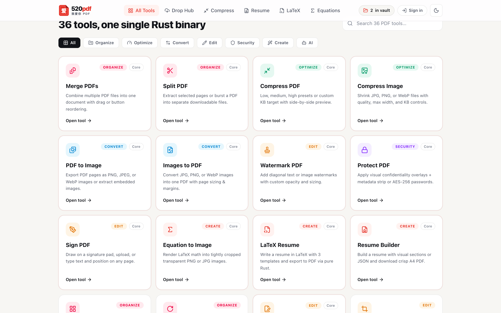
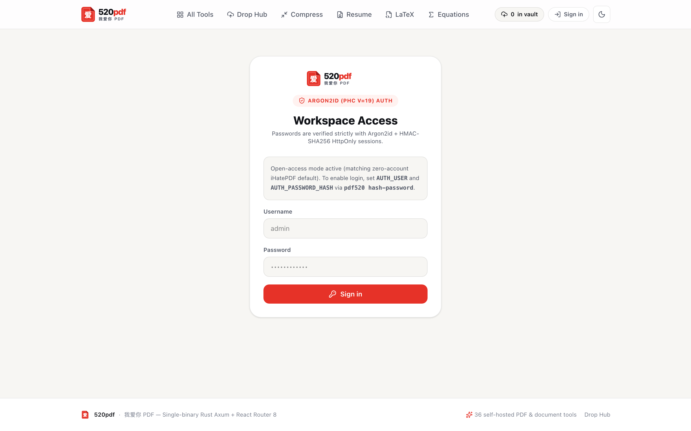
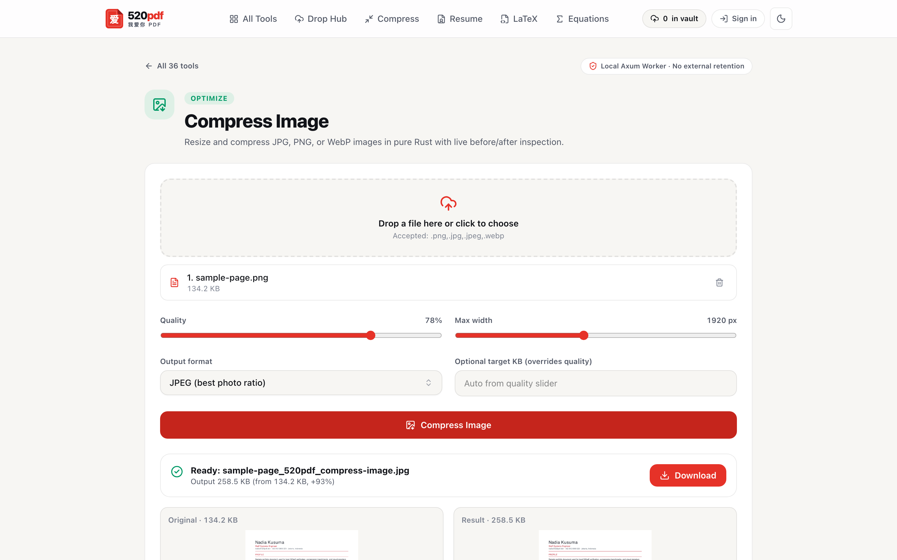
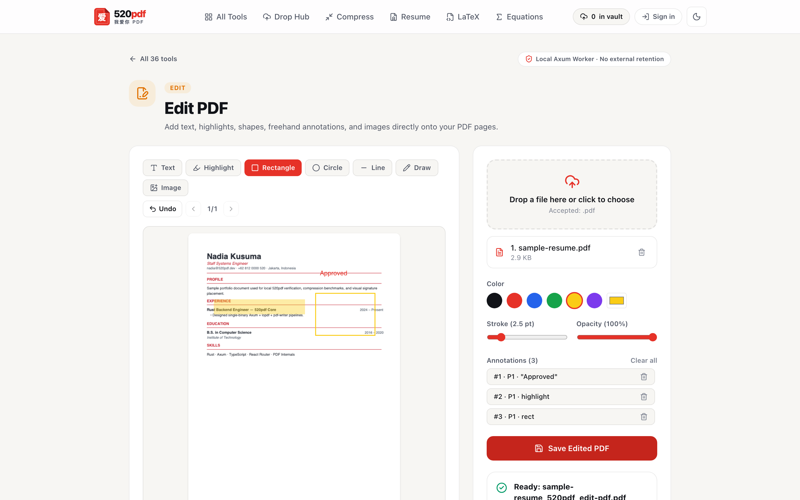
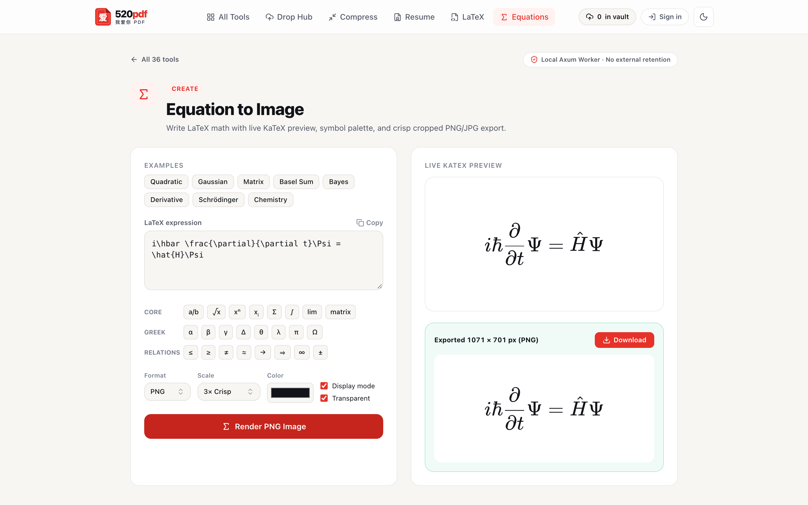

<p align="center">
  <picture>
    <source media="(prefers-color-scheme: dark)" srcset="web/public/brand-assets/logo_dark.svg">
    <source media="(prefers-color-scheme: light)" srcset="web/public/brand-assets/logo.svg">
    
  </picture>
</p>

<h2 align="center">520pdf · 我爱你 PDF (<em>wǒ ài nǐ PDF</em> — &ldquo;I love you, PDF&rdquo; · &ldquo;Cinta PDF&rdquo;)</h2>
<p align="center"><strong>The fast, private single-binary PDF &amp; media workbench — Rust (Axum) + React Router rewrite of iHatePDF</strong></p>

<p align="center">
  <a href="https://github.com/aphelion31/520pdf/releases"></a>
  
  
  
  
</p>

> **Why 520 (我爱你 · 爱)?** In Chinese internet culture, **520** (*wǔ èr líng*) sounds like **我爱你** (*wǒ ài nǐ*, *"I love you"* / **cinta PDF**), crowned by the crimson Chinese seal **爱** (*ài*, love) on the logo. **520pdf** turns that love into a single-binary Rust + React Router 8 rewrite and expansion of [iHatePDF](https://github.com/cu-sanjay/iHatePDF): Express (`dist/index.js`) is replaced by compiled Rust (`Axum 0.8` + `lopdf` + `mozjpeg` + `pdf-writer` + `image`), and the frontend is rebuilt with **React Router 8 + React 19 + Tailwind CSS v4 + Vite 8** (Bun `1.4.4`), served directly from `pdf520` with zero Node runtime in production. `iHatePDF` is © cu-sanjay, MIT licensed (see [`LICENSE-IHATEPDF`](LICENSE-IHATEPDF)). `520pdf` is not affiliated with iHatePDF or iLovePDF.

---

### ⚡ Single binary, ~7.6–24 MiB RAM locally

One compiled executable (**7.89 MiB** release binary + **4.57 MiB** static `web/build/client` bundle on macOS `arm64`, using **7.61 MiB** RSS idle and **23.86 MiB** under load). No Node.js runtime, no `node_modules` (`426.88 MiB` eliminated), and pure-Rust local execution for all 12 core `iHatePDF` workflows without Python, WeasyPrint, or TeX processes.

### 🧰 36 local PDF, Office, image & document tools

- **13/13 core `iHatePDF` + interactive tools** running natively or via local Ghostscript: Drop Hub & File Vault, Merge PDF, Split PDF (`extract` or `all` ZIP), Compress PDF (`low` / `medium` / `high` / target KB + `250 KB` floor + side-by-side page comparison), Compress Image (`jpeg` / `webp` / `png` + quality & max width), PDF to Image (rasterize pages or **extract embedded images** to ZIP), Image to PDF, Watermark PDF (custom multi-count / `3×3` grids, custom RGB color, image/logo upload), Lock/Protect PDF (pure-Rust visual protection + metadata strip or `qpdf` AES-256), Sign PDF (drag/resize signature overlay + live pad), **Edit PDF** (interactive text, highlight, shapes, freehand drawing & image overlay), Equation to Image (live KaTeX + tight cropped PNG/JPG), Resume Builder (`pdf-writer 0.15` A4 PDF), and LaTeX Resume (3 live-preview templates compiled directly to A4 PDF in Rust).
- **23 additional PDF, Office & AI tools**: Bidirectional pure-Rust Office converters (**PDF to Word `.docx`**, **PDF to PowerPoint `.pptx`**, **PDF to Excel `.xlsx`**, **Word to PDF**, **PowerPoint to PDF**, **Excel/CSV to PDF**, **Office to PDF**), Organize Pages, Rotate (single PDF or batch multi-PDF ZIP), Crop, Unlock, Page Numbers, Fillable PDF Forms, Compare PDFs, PDF to Markdown (Poppler + pure-Rust fallback), offline HTML to PDF (file upload or pasted markup, SSRF-safe), PDF/A-2, Scan to PDF, OCR PDF, Repair PDF, Permanent Redact, plus opt-in AI Summarize & Translate (`/tools/:toolId`).

### 🔒 Security, Argon2id Auth & REA Verification

- **Optional Workspace Authentication (`src/http/auth.rs`)**: Open-access by default (`AUTH_USER` unset, matching `iHatePDF` zero-account ergonomics). Setting `AUTH_USER` + `AUTH_PASSWORD_HASH` enables Argon2id (`Algorithm::Argon2id`, `Version::V0x13`) verification with constant-time compare, `HMAC-SHA256` signed `HttpOnly` `520pdf_session` cookies, `/login`, and `pdf520 hash-password`. Webhook docs (`src/http/webhook.rs`) likewise verify `DOCS_PASSWORD_HASH` using Argon2id.
- **Shipped-Artifact Audit (`docs/REA-AUDIT.md`)**: Inspected with REA (`inspect_binary_hardening` + `audit_release_exposure`) on `target/release/pdf520` (`MH_PIE`, stack protector, non-executable stack/heap, code signature, `exposed: 0`) and `web/build/client` (`exposed: 0`).

---

## UI Screenshots

All screenshots below were captured cleanly at `1440×900` (`2×` retina DPR) against the local `--release` `pdf520 serve` binary via headless Chromium (`tools/e2e.mjs`) with zero console errors, zero page errors, zero failed HTTP requests, and responsive mobile verification.

### Drop Hero & 36-Tool Icon Grid

| Workspace Home & File Vault | All 36 Tools & Category Filter |
| --- | --- |
|  |  |

### Optional Argon2id Sign In (`/login`)



### Compress PDF & Compress Image

| Compress PDF | Compress Image |
| --- | --- |
|  |  |

### Interactive Sign PDF, Edit PDF & Watermark PDF

| Sign PDF (Draggable Pad & Page Preview) | Edit PDF (Text, Highlights, Shapes & Draw) | Watermark PDF (Multi-Tile Grid & Color) |
| --- | --- | --- |
|  |  |  |

### Equation to Image, Resume Builder & LaTeX Resume (`pdf-writer 0.15`)

| Equation to Image (KaTeX -> PNG/JPG) | Resume Builder (A4 Preview + Rust PDF) | LaTeX Resume (3 Templates + Rust PDF) |
| --- | --- | --- |
|  |  |  |

---

## Original vs Rewrite Size Comparison

Measured directly on the checked-out upstream [`iHatePDF`](https://github.com/cu-sanjay/iHatePDF) tree vs `520pdf` (`src/`, `web/`, and `--release` build on macOS `arm64`) via [`tools/bench.sh`](tools/bench.sh):

| Metric | iHatePDF (Original) | 520pdf (Rust Rewrite) | Difference |
| --- | --- | --- | --- |
| **Backend source** | 5 files · 232 LOC (`server/` + `shared/`, 6.4 KiB) | 12 files · 7,328 LOC (`src/*.rs`, 253.5 KiB) | Full PDF/media/resume engine + Argon2id auth in Rust |
| **Frontend source** | 90 files · 11,682 LOC (`client/src`, 416.6 KiB) | 28 files · 4,758 LOC (`web/app`, 172.8 KiB) | **2.5× fewer LOC** |
| **Direct dependencies** | 91 npm packages (70 + 21 dev) | 19 Rust crates + 16 npm packages (7 + 9 dev) | **2.6× fewer deps** |
| **Clean source tree** (excl. `.git`, deps, build) | `1.12 MiB` | `5.35 MiB` | Self-contained (incl. `2.74 MiB` `pdfjs` + `1.97 MiB` screenshots) |
| **Runtime footprint** | `4.84 MiB` `dist/` + `426.88 MiB` `node_modules/` | **`7.89 MiB` binary + `4.57 MiB` `web/build/client`** | **No Node runtime (`426.88 MiB` eliminated)** |
| **Tools / capabilities** | 12 client-side tools | **36 tools** (13 core + 23 PDF, Office & AI tools) | **3.0× broader toolkit** |

<details>
<summary>Breakdown of built 520pdf artifacts (<code>target/release/pdf520</code> &amp; <code>web/build/client</code>)</summary>

- Release executable (`target/release/pdf520`): **`8,275,792` bytes** (`7.89 MiB`)
- Static React Router 8 SPA (`web/build/client`): **`4,789,218` bytes** (`4.57 MiB`)
  - JS, CSS & KaTeX fonts (`assets/`): `1,906,971` bytes (`1.82 MiB`)
  - Vendored `pdfjs` viewer/worker (`pdfjs/`): `2,878,275` bytes (`2.74 MiB`)
  - Geometric SVG brand assets (`brand-assets/`): `1,548` bytes (`1.5 KiB`)

</details>

---

## Benchmark

Measured with [`tools/bench.sh`](tools/bench.sh) on macOS `arm64`: [oha](https://github.com/hatoo/oha), `10 s`, `32` concurrent connections, comparing production `iHatePDF` (`NODE_ENV=production node dist/index.js`) against `520pdf` (`target/release/pdf520 serve`).

| Metric | iHatePDF (Node/Express) | 520pdf (Rust/Axum `--release`) | Speedup / Delta |
| --- | --- | --- | --- |
| **Runtime processes** | 2 (`node dist/index.js`) | 1 (`pdf520 serve`) | Single binary |
| **Cold startup to `200`** | `630 ms` | `172 ms` | **3.7× faster** |
| **Memory at idle (RSS)** | `81.94 MiB` | `7.61 MiB` | **10.8× less RAM** |
| **Memory after load (RSS)** | `147.22 MiB` | `23.86 MiB` | **6.2× less RAM** |
| `GET /api/status` | `17,403 req/s` · p50 `1.49 ms` · p99 `11.43 ms` | **`85,628 req/s` · p50 `0.27 ms` · p99 `1.94 ms`** | **4.9× throughput** |
| `GET /` (SPA HTML) | `30,428 req/s` · p50 `1.01 ms` · p99 `1.79 ms` | `15,370 req/s` · p50 `1.71 ms` · p99 `9.20 ms` | `0.5×` (dynamic gzip/br enabled) |

Read these numbers fairly:

- On `GET /api/status`, both servers serialize equivalent JSON health payloads (`{"status":"ok","timestamp":"..."}`), where Axum delivers **4.9× higher throughput** at **5.5× lower median latency**.
- On `GET /`, `520pdf` runs `tower_http::CompressionLayer` (dynamic gzip/brotli on every response to save wire bandwidth), whereas Express `serve-static` sends uncompressed HTML directly; uncompressed `ServeDir` throughput is higher.
- Because macOS Control Center listens on port `5000` and Node `reusePort: true` fails with `ENOTSUP` on macOS, `tools/bench.sh` launches `iHatePDF` from an isolated `/tmp` copy patched to `PORT=3901` and `reusePort: false` while leaving the upstream checkout untouched. Rerun `./tools/bench.sh ../iHatePDF` on your own hardware.

---

## Layout

```text
src/            Rust backend (Axum 0.8, Argon2id auth, lopdf, mozjpeg, pdf-writer 0.15, Ghostscript/qpdf orchestration)
web/            React Router 8 + React 19 + Tailwind CSS v4 + Vite 8 SPA built with Bun 1.4.4 (`web/build/client`)
tools/          API smoke check (`smoke.sh`), headless Chromium E2E & screenshot capture (`e2e.mjs`), `oha` benchmark (`bench.sh`)
tests/          Rust integration test & container conversion checks
docker/         Hardened multi-stage Bun + Rust + Ubuntu 24.04 Dockerfile & nginx reverse proxy config
docs/           Tool contracts (`TOOLS.md`), architecture notes (`structure.md`), REA audit (`REA-AUDIT.md`), screenshots (`screenshots/`)
rust/           Whole-app port map (`MAP.md`), decisions (`DECISIONS.md`), handoff (`HANDOFF.md`), `cutover.sh`, `app-cases/`
```

---

## Quick Start

```bash
# 1. Build the React Router 8 SPA (outputs web/build/client)
(cd web && bun install --frozen-lockfile && bun run build)

# 2. Build & run the single-binary Axum server
cargo build --release --locked
WEB_DIR=web/build/client ./target/release/pdf520 serve
# -> http://127.0.0.1:8080
```

CLI compressor & Argon2id password hash generator:

```bash
./target/release/pdf520 input.pdf -t 250 -o output.pdf
./target/release/pdf520 hash-password 'replace-with-strong-password'
```

Docker runtime (includes Ghostscript, QPDF, LibreOffice, Poppler, ImageMagick, Tesseract, OCRmyPDF, MuPDF):

```bash
cp .env.example .env
docker compose up -d --build
```

## Environment Variables

| Variable | Default | Purpose |
| --- | --- | --- |
| `BIND_ADDR` / `BIND` | `127.0.0.1:8080` | HTTP listen address (`PORT` supported as fallback) |
| `WEB_DIR` | `web/build/client` | Path to built React Router static client bundle |
| `AUTH_USER` | unset | Enables Argon2id + signed cookie auth for `/api/tools/*` when non-empty |
| `AUTH_PASSWORD_HASH` | unset | Argon2id PHC hash (`$argon2id$v=19$...`, recommended over `AUTH_PASSWORD`) |
| `AUTH_SECRET` | random per boot | 32+ byte HMAC key for `520pdf_session` cookies (set stably in production) |
| `WEBHOOK_SECRET` | unset | Enables legacy `pdf520 webhook` mode |
| `DOCS_USER` / `DOCS_PASSWORD_HASH` | unset | Argon2id credentials protecting legacy `/docs` in webhook mode |
| `AI_API_URL` / `AI_API_KEY` / `AI_MODEL` | unset | Opt-in OpenAI-compatible backend for `summarize` and `translate` (`consent=true` required) |

## API, Privacy & Limits

- `GET /health`, `GET /ready`, `GET /api/status`: readiness and JSON status probes.
- `GET /api/tools`: JSON catalog of all 36 tools, accepted extensions, routes, and option fields.
- `POST /api/tools/{tool}`: multipart upload + options, returning the processed file download (`50 MiB` max payload, `30` files, `2` concurrent jobs; per-job temp dirs are deleted immediately after completion).
- `GET /api/auth/me`, `POST /api/auth/login`, `POST /api/auth/logout`: Argon2id session status and sign-in endpoints.
- See [`docs/TOOLS.md`](docs/TOOLS.md) for conversion security boundaries, redaction coordinate guarantees, and opt-in AI disclosure rules.

---

## Tests

```bash
cargo fmt --check                                         # formatting check
cargo clippy --all-targets -- -D warnings                 # zero-warning lint gate
cargo test --locked                                       # 47 unit tests + integration checks
(cd web && bun run typecheck && bun run build)            # React Router typegen, tsc & Vite bundle
BASE=http://127.0.0.1:8089 ./tools/smoke.sh               # API + PDF/image/Argon2id roundtrip smoke suite
BASE=http://127.0.0.1:8089 node tools/e2e.mjs             # Headless Chromium E2E + retina screenshot suite
```

## License

MIT (see [`LICENSE`](LICENSE)). Includes compatibility, UI workflow inspiration, and tool parity derived from [`cu-sanjay/iHatePDF`](https://github.com/cu-sanjay/iHatePDF) (MIT, © cu-sanjay, see [`LICENSE-IHATEPDF`](LICENSE-IHATEPDF)).
