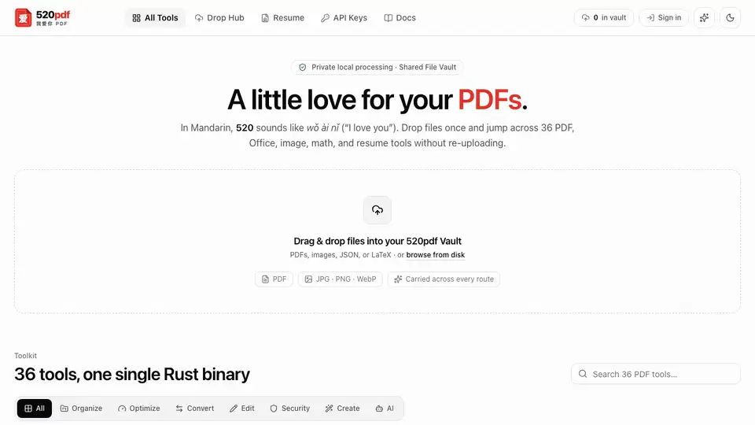
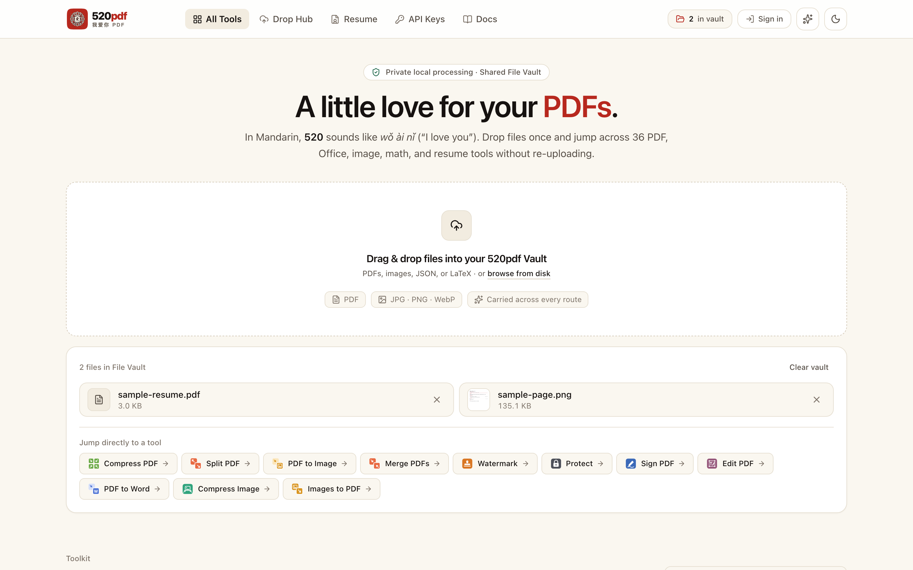
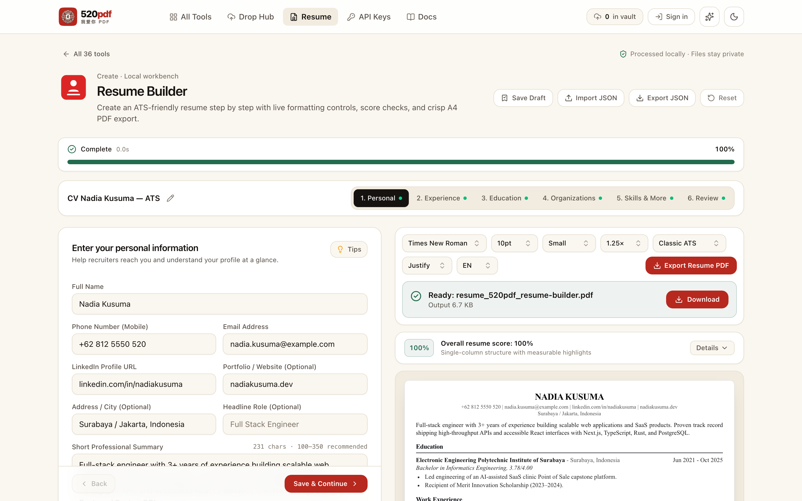
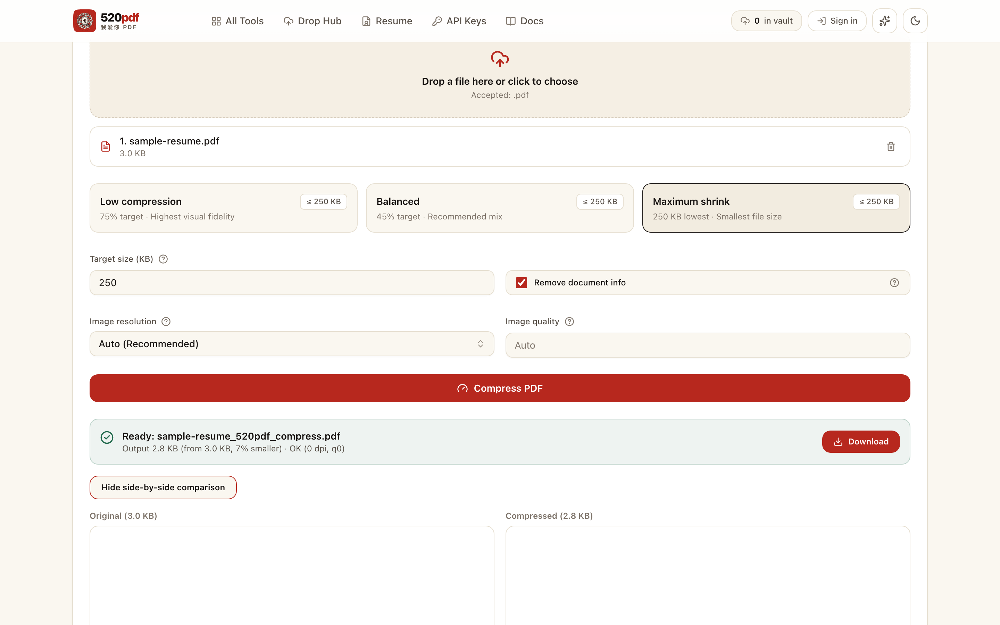
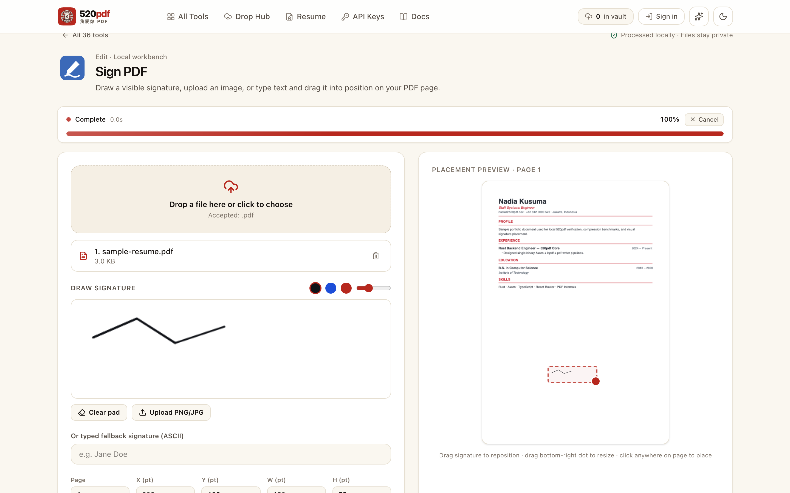
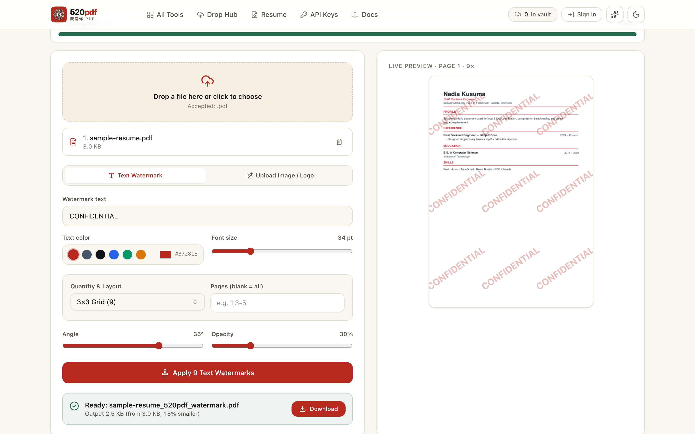
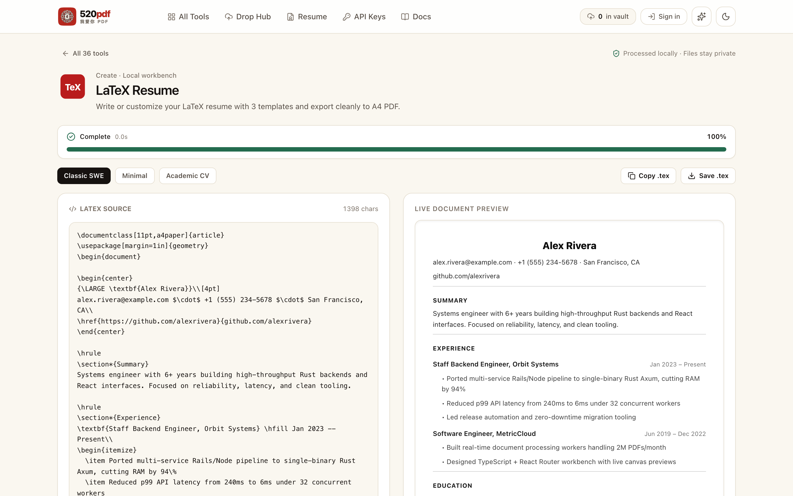
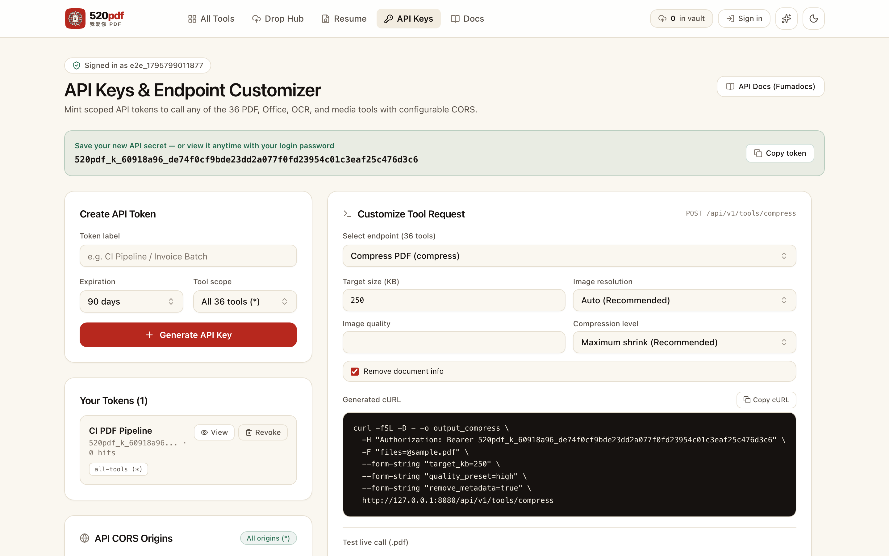
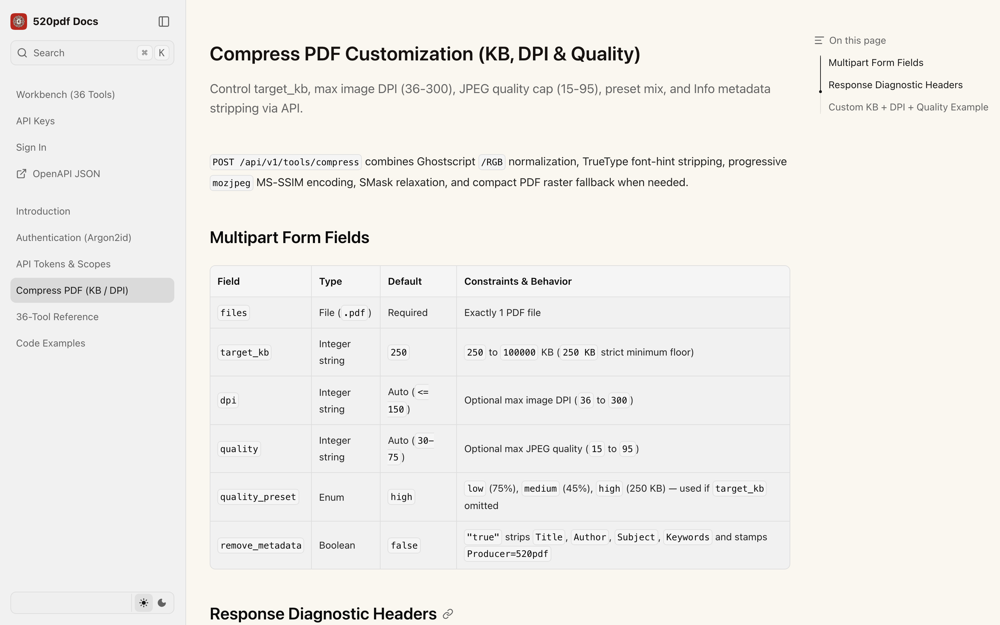
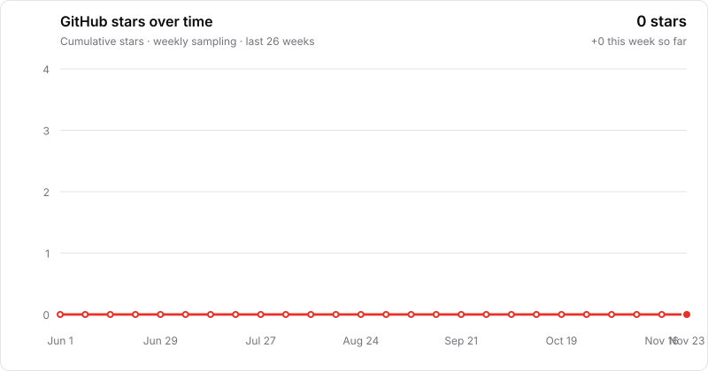

<div align="center">

<picture>
  <source media="(prefers-color-scheme: dark)" srcset="web/public/brand-assets/logo_dark.svg">
  
</picture>

# 520pdf

<p>
  <strong>Private, single-binary PDF &amp; document workbench.</strong><br>
  36 local PDF, Office, OCR, image, and ATS resume tools in one Rust binary — 10.8× less RAM, 4.9× faster API, zero Node runtime.
</p>

[](https://github.com/aphelion31/520pdf/commits/master)
[](https://github.com/aphelion31/520pdf/stargazers)
[](https://github.com/aphelion31/520pdf/releases)
[](LICENSE)

[](src/http/workbench.rs)
[](web/app/root.tsx)
[](src/http/auth.rs)

</div>

<div align="center">

  <a href="docs/media/demo.mp4">
    
  </a>

  <p><em>Live walkthrough: File Vault, Compress PDF, 6-step ATS Resume Builder, password-gated API Keys &amp; CORS (1x speed)</em></p>

</div>

<div align="center">

## Quick Start

</div>

```bash
# 1. Build the React Router 8 SPA (outputs web/build/client)
(cd web && bun install --frozen-lockfile && bun run build)

# 2. Build & run the single-binary Axum server
cargo build --release --locked
WEB_DIR=web/build/client ./target/release/pdf520 serve
# -> http://127.0.0.1:8080
```

CLI compressor & Argon2id password hash generator:

```bash
./target/release/pdf520 input.pdf -t 250 -o output.pdf
./target/release/pdf520 hash-password 'replace-with-strong-password'
```

Docker runtime (includes Ghostscript, QPDF, LibreOffice, Poppler, ImageMagick, Tesseract, OCRmyPDF, MuPDF):

```bash
cp .env.example .env
docker compose up -d --build
```

<div align="center">

## Benches

</div>

### RAM, startup & throughput vs Express (`iHatePDF`)

Measured with [`tools/bench.sh`](tools/bench.sh) on macOS `arm64`: [oha](https://github.com/hatoo/oha), `10 s`, `32` concurrent connections, comparing production `iHatePDF` (`NODE_ENV=production node dist/index.js`) against `520pdf` (`target/release/pdf520 serve`).

| Metric | iHatePDF (Node/Express) | 520pdf (Rust/Axum `--release`) | Speedup / Delta |
| --- | --- | --- | --- |
| **Runtime processes** | 2 (`node dist/index.js`) | 1 (`pdf520 serve`) | Single binary |
| **Cold startup to `200`** | `630 ms` | **`172 ms`** | **3.7× faster** |
| **Memory at idle (RSS)** | `81.94 MiB` | **`7.61 MiB`** | **10.8× less RAM** |
| **Memory after load (RSS)** | `147.22 MiB` | **`23.86 MiB`** | **6.2× less RAM** |
| `GET /api/status` | `17,403 req/s` · p50 `1.49 ms` | **`85,628 req/s` · p50 `0.27 ms`** | **4.9× throughput** |
| `GET /` (SPA HTML) | `30,428 req/s` · p50 `1.01 ms` | `15,370 req/s` · p50 `1.71 ms` | `0.5×` (dynamic gzip/br) |

[Reproduce](tools/bench.sh).

### Original vs Rewrite Size

| Metric | iHatePDF (Original) | 520pdf (Rust Rewrite) | Difference |
| --- | --- | --- | --- |
| **Backend source** | 5 files · 232 LOC (`server/` + `shared/`) | 12 files · 7,328 LOC (`src/*.rs`) | Full PDF/media/resume engine + Argon2id auth in Rust |
| **Frontend source** | 90 files · 11,682 LOC (`client/src`) | 28 files · 4,758 LOC (`web/app`) | **2.5× fewer LOC** |
| **Direct dependencies** | 91 npm packages (70 + 21 dev) | 19 Rust crates + 16 npm packages | **2.6× fewer deps** |
| **Runtime footprint** | `4.84 MiB` `dist/` + `426.88 MiB` `node_modules/` | **`9.17 MiB` binary + `6.62 MiB` `web/build/client`** | **No Node runtime (`426.88 MiB` eliminated)** |
| **Tools / capabilities** | 12 client-side tools | **36 tools** (13 core + 23 PDF, Office & AI) | **3.0× broader toolkit** |

Read these numbers fairly:

- On `GET /api/status`, both servers serialize equivalent JSON health payloads (`{"status":"ok","timestamp":"..."}`), where Axum delivers **4.9× higher throughput** at **5.5× lower median latency**.
- On `GET /`, `520pdf` enables `tower_http::CompressionLayer` (dynamic gzip/brotli on every response to save wire bandwidth), whereas Express `serve-static` sends uncompressed HTML directly.
- Because macOS Control Center listens on port `5000` and Node `reusePort: true` fails with `ENOTSUP` on macOS, `tools/bench.sh` launches `iHatePDF` from an isolated `/tmp` copy patched to `PORT=3901` and `reusePort: false` while leaving the upstream checkout untouched.

<details>
<summary>Breakdown of built 520pdf artifacts (<code>target/release/pdf520</code> &amp; <code>web/build/client</code>)</summary>

- Release executable (`target/release/pdf520`): **`9,618,864` bytes** (`9.17 MiB`)
- Static React Router 8 SPA (`web/build/client`): **`6,942,804` bytes** (`6.62 MiB`)
  - JS, CSS, Fumadocs & KaTeX fonts (`assets/`): `2,706,025` bytes (`2.58 MiB`)
  - Vendored `pdfjs` viewer/worker (`pdfjs/`): `2,878,275` bytes (`2.74 MiB`)
  - Copperplate SVG/PNG brand assets (`brand-assets/`): `1,347,320` bytes (`1.28 MiB`)

</details>

<div align="center">

## Screenshots

Captured at `1440×900` (`2×` retina DPR) against the local `--release` `pdf520 serve` binary via [`tools/e2e.mjs`](tools/e2e.mjs) with zero console, page, or network errors.

<table>
  <tr>
    <td align="center"><a href="docs/screenshots/home.png"></a><br>Workspace Home &amp; File Vault</td>
    <td align="center"><a href="docs/screenshots/tools-grid.png"></a><br>36-Tool Grid &amp; Category Tabs</td>
  </tr>
  <tr>
    <td align="center"><a href="docs/screenshots/resume-builder.png"></a><br>6-Step ATS Resume Builder (<code>pdf-writer 0.15</code>)</td>
    <td align="center"><a href="docs/screenshots/compress-pdf.png"></a><br>Compress PDF &amp; Side-by-Side Compare</td>
  </tr>
  <tr>
    <td align="center"><a href="docs/screenshots/sign-pdf.png"></a><br>Sign PDF (Draggable Pad &amp; Preview)</td>
    <td align="center"><a href="docs/screenshots/edit-pdf.png"></a><br>Edit PDF (Text, Highlights &amp; Shapes)</td>
  </tr>
  <tr>
    <td align="center"><a href="docs/screenshots/watermark-pdf.png"></a><br>Watermark PDF (Multi-Tile Grid &amp; Color)</td>
    <td align="center"><a href="docs/screenshots/compress-image.png"></a><br>Compress Image (JPEG / WebP / PNG)</td>
  </tr>
  <tr>
    <td align="center"><a href="docs/screenshots/equation-to-image.png"></a><br>Equation to Image (KaTeX -&gt; PNG/JPG)</td>
    <td align="center"><a href="docs/screenshots/latex-resume.png"></a><br>LaTeX Resume (3 Templates -&gt; Rust PDF)</td>
  </tr>
  <tr>
    <td align="center"><a href="docs/screenshots/api-keys.png"></a><br>API Keys, Password Reveal &amp; CORS Origins</td>
    <td align="center"><a href="docs/screenshots/login.png"></a><br>Argon2id Sign In / Register</td>
  </tr>
</table>

<p>
  <a href="docs/screenshots/fumadocs.png"></a><br>
  <em>Fumadocs 16 API Documentation (<code>/docs</code>)</em>
</p>

</div>

## 36 Local Tools & Live Progress

- **13 core interactive tools**: Drop Hub & File Vault, Merge PDF, Split PDF (`extract` or `all` ZIP), Compress PDF (`low` / `medium` / `high` / target KB + `250 KB` floor + side-by-side comparison), Compress Image (`jpeg` / `webp` / `png` + quality & max width), PDF to Image (rasterize pages or extract embedded images to ZIP), Image to PDF, Watermark PDF (custom multi-count / `3×3` grids, RGB color, image/logo upload), Lock/Protect PDF (pure-Rust visual protection + metadata strip or `qpdf` AES-256), Sign PDF (drag/resize signature overlay + live pad), Edit PDF (text, highlight, shapes, freehand & image overlay), Equation to Image (live KaTeX + tight PNG/JPG), 6-step ATS **Resume Builder** (`pdf-writer 0.15` A4 PDF), and **LaTeX Resume**.
- **23 additional PDF, Office & AI tools**: Bidirectional pure-Rust Office converters (**PDF to Word `.docx`**, **PDF to PowerPoint `.pptx`**, **PDF to Excel `.xlsx`**, **Word to PDF**, **PowerPoint to PDF**, **Excel/CSV to PDF**, **Office to PDF**), Organize Pages, Rotate (single or multi-PDF ZIP), Crop, Unlock, Page Numbers, Fillable PDF Forms, Compare PDFs, PDF to Markdown, offline SSRF-safe HTML to PDF, PDF/A-2, Scan to PDF, OCR PDF, Repair PDF, Permanent Redact, plus opt-in AI Summarize & Translate (`/tools/:toolId`).
- **Interactive `%` Job Progress**: All 36 tools stream real upload/download bytes and poll `GET /api/jobs/{id}` (`X-Job-Id`) with real Rust compression milestones and cancel support (`ToolProgressBar`).

## Auth, API Keys & Configurable CORS

- **Argon2id Accounts & Scoped Tokens (`src/http/auth.rs`, `src/http/tokens.rs`)**: Open-access workbench by default, or gate `/api/tools/*` + `/api/v1/tools/*` via `REQUIRE_API_KEY=true` / `AUTH_USER`. Creating, listing, revealing, and revoking `520pdf_k_...` tokens require an Argon2id (`PHC v=19`) session. Tokens store `SHA-256` hashes plus Encrypt-then-MAC (`HMAC-SHA256`) sealed payloads in `$DATA_DIR/store.json` (`0600`) so owners can re-reveal secrets via `POST /api/tokens/{id}/reveal` only after re-entering their login password.
- **Configurable API CORS (default `*`)**: All `/api/*` endpoints ship with `Access-Control-Allow-Origin: *` by default (`CORS_ORIGINS=*`). Signed-in users can add/remove explicit origins or toggle `*` live in `/api-keys` (`GET`/`PUT /api/cors`), granting `Access-Control-Allow-Credentials: true` + `Vary: Origin` for allowlisted origins while rejecting unlisted origins.
- **Fumadocs & OpenAPI (`/docs`, `/api/openapi.json`)**: Embedded Fumadocs 16 + MDX guide with live search (`/api/docs/search`) and dynamic OpenAPI 3.1 schema.
- **Shipped-Artifact Audit**: Inspected via REA (`docs/REA-AUDIT.md`) on `target/release/pdf520` (`MH_PIE`, stack protector, NX, code signature, `exposed: 0`) and `web/build/client` (`exposed: 0`).

## Environment Variables & API

| Variable | Default | Purpose |
| --- | --- | --- |
| `BIND_ADDR` / `BIND` | `127.0.0.1:8080` | HTTP listen address (`PORT` supported as fallback) |
| `WEB_DIR` | `web/build/client` | Path to built React Router static client bundle |
| `CORS_ORIGINS` / `CORS_ORIGIN` | `*` | Comma-separated allowed CORS origins for `/api/*` |
| `AUTH_USER` | unset | Enables Argon2id + signed cookie auth for `/api/tools/*` when non-empty |
| `AUTH_PASSWORD_HASH` | unset | Argon2id PHC hash (`$argon2id$v=19$...`, recommended over `AUTH_PASSWORD`) |
| `AUTH_SECRET` | random per boot | 32+ byte HMAC key for `520pdf_session` cookies & token vault pepper |
| `DATA_DIR` | `.520pdf-data` | Persistent storage for Argon2id accounts, tokens & CORS settings |
| `REQUIRE_API_KEY` | `false` | Require `Authorization: Bearer` / `X-API-Key` or session on `/api/*tools*` |
| `DISABLE_REGISTRATION` | `false` | Disable public `POST /api/auth/register` account creation |
| `DOCS_USER` / `DOCS_PASSWORD_HASH` | unset | Argon2id credentials protecting legacy `/docs` in webhook mode |
| `AI_API_URL` / `AI_API_KEY` / `AI_MODEL` | unset | Opt-in OpenAI-compatible backend for `summarize` and `translate` (`consent=true`) |

Key endpoints:
- `GET /health`, `GET /ready`, `GET /api/status`, `GET /api/tools`, `GET /api/openapi.json`, `GET /api/docs/search`
- `POST /api/tools/{tool}` & `POST /api/v1/tools/{tool}` (`Authorization: Bearer` / `X-API-Key`, `X-Job-Id`, `50 MiB` max payload)
- `GET /api/jobs/{id}`: Live job percentage & stage polling
- `GET/POST /api/tokens`, `POST /api/tokens/{id}/reveal`, `DELETE /api/tokens/{id}`, `GET/PUT /api/cors`

## Layout & Tests

```text
src/            Rust backend (Axum 0.8, Argon2id auth, CORS middleware, lopdf, mozjpeg, pdf-writer 0.15)
web/            React Router 8 + React 19 + Tailwind CSS v4 + Vite 8 SPA built with Bun (`web/build/client`)
tools/          API smoke (`smoke.sh`), Playwright E2E (`e2e.mjs`), demo recorder (`record-demo.mjs`), `oha` bench (`bench.sh`)
tests/          Rust integration test & container conversion checks
docker/         Hardened multi-stage Bun + Rust + Ubuntu 24.04 Dockerfile & nginx reverse proxy config
docs/           Tool contracts (`TOOLS.md`), REA audit (`REA-AUDIT.md`), screenshots, demo media & star chart
.github/        Release automation + daily `github-actions[bot]` weekly stars chart workflow
```

```bash
cargo fmt --check                                         # formatting check
cargo clippy --all-targets -- -D warnings                 # zero-warning lint gate
cargo test --locked                                       # 59 unit + 1 integration tests (1 runtime-deps test ignored)
(cd web && bun run typecheck && bun run build)            # React Router typegen, tsc & Vite bundle
BASE=http://127.0.0.1:8080 ./tools/smoke.sh               # API, CORS, token reveal & conversion smoke suite
BASE=http://127.0.0.1:8080 node tools/e2e.mjs             # Headless Chromium E2E + 13 retina screenshots
```

<div align="center">

## Star History

<p>
  
</p>

<p><em>Updated automatically by <code>github-actions[bot]</code> via <a href=".github/workflows/update-star-history.yml">update-star-history.yml</a>.</em></p>

</div>

## License

MIT (see [`LICENSE`](LICENSE)). Includes compatibility, UI workflow inspiration, and tool parity derived from [`cu-sanjay/iHatePDF`](https://github.com/cu-sanjay/iHatePDF) (MIT, © cu-sanjay, see [`LICENSE-IHATEPDF`](LICENSE-IHATEPDF)). In Mandarin, **520** (*wǔ èr líng*) sounds like **我爱你** (*wǒ ài nǐ*, *"I love you"*), represented by the seal **爱** on the logo. `520pdf` is not affiliated with iHatePDF or iLovePDF.
